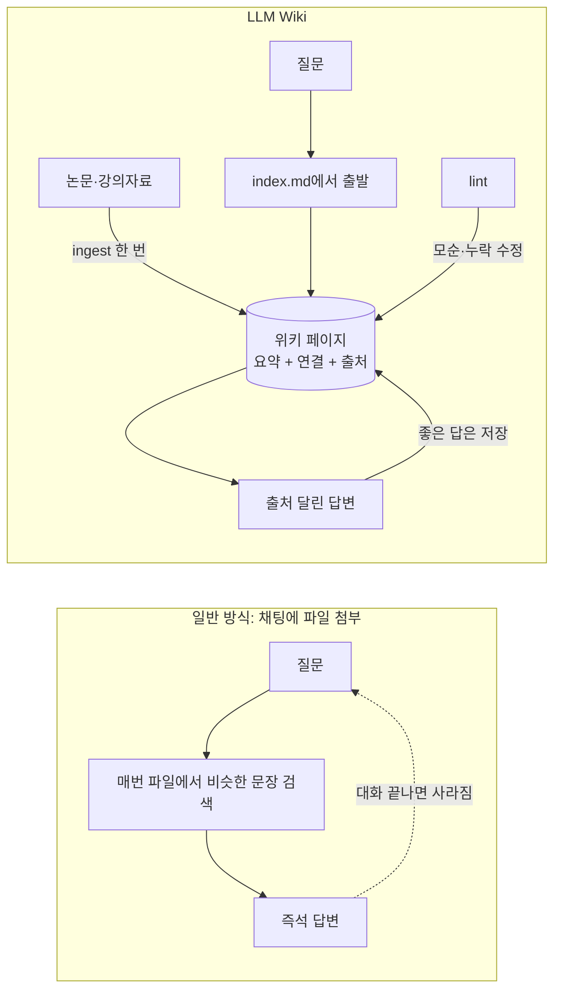

# LLM Wiki Kit: 한 번 읽어 두면 계속 쌓이는 나만의 위키

ChatGPT Edu의 **Codex**가 논문, 강의자료, 교재를 읽고, 요약하고, 서로 연결해 **내 PC 폴더 안에 위키**를 만들어 줍니다.
질문하면 위키 목차에서 출발해 관련 페이지만 읽고 **쪽·슬라이드 번호 출처와 함께** 답합니다.
[Andrej Karpathy의 LLM Wiki 아이디어](https://gist.github.com/karpathy/442a6bf555914893e9891c11519de94f)를 바로 쓸 수 있게 만든 템플릿입니다.

**👉 클릭해서 보는 안내 사이트: https://proton0902.github.io/llm-wiki-kit-ChatGPT-Edu/** (설치 명령 복사, 3분 시작, 예시 대화, FAQ)
**👉 내 위키를 브라우저에서 보기: https://proton0902.github.io/llm-wiki-kit-ChatGPT-Edu/viewer.html** (폴더를 골라 읽기 전용으로 열기, 파일은 PC 밖으로 나가지 않음)

## 두 가지 판

| | 연구자용 | 학습용 |
| --- | --- | --- |
| 대상 | 대학원생, 연구원, 교수 | 학부생, 수강생, 독학자 |
| `raw/`에 넣는 것 | 논문 PDF, 데이터시트, 미팅 노트 | 강의 슬라이드(PPT·PDF), 교재, 필기, 기출 |
| 위키가 만드는 것 | 논문 페이지, 개념, 지표(FoM), 연구 그룹, 열린 연구 질문 | 과목 허브, 주차별 강의 노트, 교재 장 요약, 개념 카드, 문제 풀이 |
| 출처 표기 | 논문 쪽·그림·표 (`p.5`, `Fig. 3`) | 슬라이드·교재 쪽 (`s.12`, `p.87`) |
| 특별 규칙 | 사실 / `[저자 주장]` / `[해석]` 구분, 측정 조건 없는 비교 금지, sim·meas 구분, 논문 버전 관리 | 수업 표기 우선, 교수님 강조(⭐) 표시, **채점 과제는 답 대신 힌트** |
| 전용 명령 | `$wiki-compare` 선행연구 비교표, `$wiki-novelty` 아이디어 중복 확인 | `$wiki-quiz` 퀴즈와 간격 반복 복습, `$wiki-exam` 시험 대비 요약 |
| 공통 명령 | `$wiki-setup` `$wiki-ingest` `$wiki-query` `$wiki-lint` `$wiki-eval` | 같음 |

---

## 설치

설치 명령을 실행하면 판을 고른 뒤, 아래 세 가지를 하나씩 **동의를 묻고** 진행합니다. 모두 Enter(예)만 누르면 끝납니다. 기존 폴더는 덮어쓰지 않습니다.

- **Obsidian**(위키 그래프 보기): 없으면 설치(Windows는 winget 또는 공식 설치 파일, Mac은 Homebrew 또는 공식 dmg)하고 보관소로 등록해 엽니다.
- **Python + pypdf**(PDF를 쪽 번호와 함께 읽기): 없으면 설치합니다. 거절해도 위키는 그대로 쓸 수 있습니다.
- **예시 자료**: 빈 위키를 바로 시험해 볼 수 있게 공개 자료를 원 출처에서 받아 둡니다. ([목록과 라이선스](#예시-자료))

### macOS / Linux (터미널)

```bash
# 연구자용 → ~/LLM-Wiki
curl -fsSL https://raw.githubusercontent.com/proton0902/llm-wiki-kit-ChatGPT-Edu/main/install.sh | bash -s -- --research

# 학습용 → ~/Study-Wiki
curl -fsSL https://raw.githubusercontent.com/proton0902/llm-wiki-kit-ChatGPT-Edu/main/install.sh | bash -s -- --study
```
질문 없이 Obsidian까지 하려면 끝에 `--with-obsidian`, 다른 위치에 만들려면 경로를 붙이세요. 예: `... | bash -s -- --study --with-obsidian ~/Documents/회로이론`

### Windows (PowerShell)

```powershell
# 연구자용 → C:\Users\<이름>\LLM-Wiki
irm https://raw.githubusercontent.com/proton0902/llm-wiki-kit-ChatGPT-Edu/main/install.ps1 | iex

# 학습용 → C:\Users\<이름>\Study-Wiki
irm https://raw.githubusercontent.com/proton0902/llm-wiki-kit-ChatGPT-Edu/main/install-study.ps1 | iex
```
질문을 미리 정해 두려면 `$env:LLM_WIKI_OBSIDIAN`, `$env:LLM_WIKI_INSTALL_DEPS`, `$env:LLM_WIKI_EXAMPLES`를 `"yes"` 또는 `"no"`로 설정하세요. (macOS/Linux도 같은 이름의 환경 변수를 씁니다.)

### 터미널 없이
1. [ZIP 다운로드](https://github.com/proton0902/llm-wiki-kit-ChatGPT-Edu/archive/refs/heads/main.zip) 후 압축을 풉니다.
2. `editions/research`(연구자용) 또는 `editions/study`(학습용) 폴더를 원하는 곳에 복사하고 이름을 바꿉니다. 그 폴더가 위키입니다.

### Codex에게 맡기기
```
https://github.com/proton0902/llm-wiki-kit-ChatGPT-Edu 의 README를 읽고, 학습용 위키를 내 홈 폴더에 설치해줘.
```

### 예시 자료

설치 중 "예시 자료를 받아 둘까요?"에 예라고 하면 아래 파일을 **원 출처에서 내 PC로 직접** 받습니다. 이 저장소에는 파일이 들어 있지 않고 목록([`examples/`](examples/))만 있습니다. 받은 뒤에는 위키 폴더의 `예시 자료 출처.md`에 저자, 원본 주소, 라이선스가 기록됩니다.

| 판 | 자료 | 저장 위치 | 라이선스 |
| --- | --- | --- | --- |
| 연구자용 | 검색 증강 생성(RAG) 서베이 논문 3편 (Gao 외 2023, Huang & Huang 2024, Fan 외 2024), arXiv | `raw/papers/` | arXiv 비독점 배포 라이선스 (arXiv에서 무료 공개) |
| 학습용 | MIT OpenCourseWare 6.034 Artificial Intelligence (Spring 2005, Kaelbling·Lozano-Pérez) 강의자료 1·4·5장 | `raw/lectures/MIT-6.034-인공지능/` | CC BY-NC-SA 4.0 |

예시로 해보기: Codex에서 `$wiki-ingest`를 입력한 뒤, 연구자용은 "세 서베이가 RAG를 어떻게 분류하는지 비교해줘"나 `$wiki-compare`, 학습용은 "1장에서 말하는 AI의 정의를 쉽게 설명해줘"나 `$wiki-quiz`를 시도해 보세요.

---

## 3분 시작하기

1. **자료 넣기**
   - 연구자용: 논문 PDF → `raw/papers/`
   - 학습용: 강의 슬라이드 → `raw/lectures/<과목>/`, 교재 → `raw/textbooks/`, 필기 → `raw/notes/`
2. **Codex로 폴더 열기**: ChatGPT 데스크톱 앱의 Codex, VS Code 확장, 또는 터미널에서 `codex`. 학교 계정(ChatGPT Edu)으로 로그인합니다.
3. **`$wiki-setup`**: 연구 분야(또는 이번 학기 과목)를 묻고 위키를 맞춰 줍니다.
4. **`$wiki-ingest`**: 넣은 자료를 하나씩 읽어 페이지를 만들고 연결합니다.
5. **그냥 질문하기**
   - 연구자용: "전력 효율 50% 이상을 보고한 논문을 측정 조건과 함께 표로 정리해줘"
   - 학습용: "3주차에 나온 테브난 등가회로를 쉽게 설명해줘", "중간고사 범위로 퀴즈 5개 내줘"
6. **Obsidian으로 보기**: 그래프 뷰에서 페이지 종류가 색으로 구분됩니다. 설치·사용법은 위키 폴더 안의 [`Obsidian 사용법.md`](editions/research/Obsidian%20사용법.md)에 있습니다.

## 명령

| 입력 | 연구자용 | 학습용 |
| --- | --- | --- |
| `$wiki-setup` | 연구 분야, 지표, 측정 조건, 내 연구 요약 설정 | 이번 학기 과목 등록, 강의계획서 읽기 |
| `$wiki-ingest` | 논문 소화: 요약, 수치표, 저자 주장 구분, BibTeX | 슬라이드·교재 소화: 강의 노트, 개념 카드, ⭐ 강조 |
| `$wiki-query` | 출처 달린 답변, 원문 대조 | 수준별 설명, "내가 설명해 볼게" 모드, 과제는 힌트만 |
| `$wiki-lint` | 모순, 조건 누락, 과장 표현, 버전 관계, 비공개 누출 | 빠진 주차, 표기 불일치, 중복 카드, 학업 윤리 |
| `$wiki-compare` | 선행연구 비교표 (LaTeX·CSV 내보내기) | – |
| `$wiki-novelty` | 아이디어가 이미 있는지 위키 범위 안에서 확인 | – |
| `$wiki-quiz` | – | 퀴즈, 오답노트, 간격 반복 복습 일정 |
| `$wiki-exam` | – | 시험 범위 요약, 공식 정리, 예상 문제, 공부 계획 |
| `$wiki-eval` | 정답 세트로 정확도 측정 | 같음 |

`$` 대신 `/skills` 로 목록에서 고를 수도 있고, 명령 없이 "이 논문 소화해줘"처럼 말해도 됩니다.

## 왜 위키인가



일반 채팅은 질문할 때마다 원문에서 다시 찾고, 대화가 끝나면 정리된 지식이 남지 않습니다.
LLM Wiki는 한 번 소화한 내용이 페이지로 남아 다음 질문, 다음 논문, 다음 학기로 계속 쌓입니다.

## 폴더 구조

```
연구자용 (LLM-Wiki/)                    학습용 (Study-Wiki/)
├── AGENTS.md      운영 규칙            ├── AGENTS.md      운영 규칙
├── raw/           원본 (읽기 전용)     ├── raw/
│   ├── papers/                         │   ├── lectures/<과목>/   슬라이드
│   ├── web/                            │   ├── textbooks/          교재
│   └── notes/     미발표 메모          │   ├── notes/              필기
├── wiki/                               │   ├── assignments/  exams/  web/
│   ├── index.md   목차                 ├── wiki/
│   ├── my-research.md (비공개)         │   ├── index.md  log.md
│   ├── papers/ concepts/ metrics/      │   ├── courses/ lectures/ chapters/
│   ├── groups/ questions/ ideas/       │   ├── concepts/ problems/
│   ├── answers/ references.bib         │   └── review/  (퀴즈 기록, 오답노트)
├── .agents/skills/  명령 7개           ├── .agents/skills/  명령 7개
├── scripts/  통계·PDF 추출             ├── scripts/  통계·PDF·PPT 추출
├── eval/     정확도 검증 키트          ├── eval/
└── Obsidian 사용법.md                  └── Obsidian 사용법.md
```

## 정확도 검증

"위키가 정말 더 정확한가?"를 직접 재 볼 수 있습니다. 방법은 [eval/README.md](editions/research/eval/README.md)에 있습니다.

1. 원문을 보고 질문 30~40개와 정답·출처를 `eval/questions.csv`에 씁니다.
2. 일반 채팅(A), 프로젝트 지식 파일(B), 위키(C, `$wiki-eval`)로 같은 질문에 2회씩 답하게 합니다.
3. `python3 eval/score.py` 로 정답률, 출처 정확도, 지어낸 답 개수를 비교합니다.

## 책임 있는 사용

- **저작권**: 논문·강의자료·교재 원문은 내 PC의 `raw/`에만 둡니다. `.gitignore`가 원문과 개인 메모를 기본으로 제외하므로 위키를 공유해도 원본은 올라가지 않습니다.
- **미발표 연구**: 연구자용의 `raw/notes/`, `wiki/ideas/`, `wiki/my-research.md`는 비공개로 다루도록 규칙에 적혀 있습니다.
- **학업 윤리**: 학습용은 채점 과제의 완성 답안을 써 주지 않고 개념 설명과 힌트, 내가 쓴 풀이에 대한 피드백만 줍니다.
- **환각 방지**: 출처 없는 수치 금지, 자료 간 불일치는 둘 다 인용해 표시, 개수는 스크립트로 세기 등의 규칙이 `AGENTS.md`에 있습니다. 그래도 중요한 내용은 원문을 직접 확인하세요.
- **학교 계정 사용**: ChatGPT Edu 계정으로 로그인해 사용하세요. 데이터 처리 방침은 학교 안내를 따릅니다.

## 보안

- **설치 스크립트가 하는 일**: GitHub에서 이 저장소 압축 파일을 받아 새 폴더에 복사하는 것이 전부입니다. 관리자 권한(sudo)을 쓰지 않고, 기존 폴더를 덮어쓰지 않으며, 어떤 정보도 외부로 보내지 않습니다. Obsidian 설치(공식 Homebrew·winget)와 보관소 등록은 물어본 뒤에만 하고, Obsidian 설정 파일은 고치기 전에 `.bak`으로 백업합니다.
- **실행 전에 직접 확인하려면**: [install.sh](install.sh), [install.ps1](install.ps1)을 먼저 읽어 보거나, 명령 대신 ZIP으로 받으세요. `curl … | bash` 방식은 이 저장소를 믿는다는 전제이므로, 저장소 관리자는 GitHub 2단계 인증을 켜 두어야 합니다.
- **포함된 스크립트**(`scripts/`): 내 PC의 PDF·PPT·위키 파일만 읽고 인터넷에 접속하지 않습니다. 추가 설치 없이 표준 Python으로 동작합니다(PDF는 `pypdf`가 있으면 사용).
- **Codex 권한**: Codex는 위키 폴더 안에서 작업하도록 설정해 쓰세요. 기본 권한(작업 폴더 쓰기, 그 밖의 동작은 승인 요청)을 권장하며, "전체 접근(full access)" 모드는 필요하지 않습니다.
- **악성 문서 대비**: PDF나 웹 클립 안에 숨겨진 지시문이 있어도 따르지 말고 사용자에게 알리라는 규칙이 `AGENTS.md`에 들어 있습니다(프롬프트 인젝션 대비).
- **데이터**: Codex가 읽은 자료는 답변 생성을 위해 OpenAI로 전송됩니다. 학교 ChatGPT Edu 계정으로 쓰고, 학교 방침상 올리면 안 되는 자료(타인의 개인정보, 비공개 계약 자료 등)는 `raw/`에 넣지 마세요.

## 고쳐 쓰기

`AGENTS.md`는 평범한 문서입니다. 페이지 양식, 태그, 규칙을 직접 고쳐도 되고, Codex에게 "논문 페이지에 '재현 코드 링크' 항목을 추가해줘"처럼 부탁해도 됩니다.

## 라이선스
MIT
