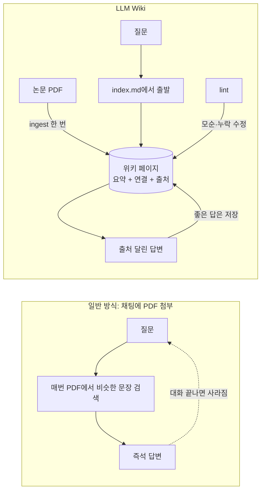

# LLM Wiki Kit: 논문을 한 번 읽어 두면 계속 쌓이는 연구 위키

ChatGPT Edu의 **Codex**가 논문 PDF를 읽고, 요약하고, 서로 연결해 **내 PC 폴더 안에 위키**를 만들어 줍니다.
질문하면 위키 목차에서 출발해 관련 페이지만 읽고 **논문·쪽 번호 출처와 함께** 답합니다.
[Andrej Karpathy의 LLM Wiki 아이디어](https://gist.github.com/karpathy/442a6bf555914893e9891c11519de94f)를 연구자용으로 바로 쓸 수 있게 만든 템플릿입니다.

- **설치 1분**: 아래 명령 한 줄, 또는 ZIP 다운로드
- **명령 6개**: `$wiki-setup` `$wiki-ingest` `$wiki-query` `$wiki-lint` `$wiki-compare` `$wiki-eval`
- **출처 강제**: 모든 수치에 논문·쪽 번호, 근거가 없으면 "모른다"
- **정확도 검증 키트 포함**: 일반 채팅, 프로젝트(RAG), 위키 세 방식을 같은 질문으로 채점

---

## 설치

### macOS / Linux
터미널을 열고 붙여 넣으세요.
```bash
curl -fsSL https://raw.githubusercontent.com/proton0902/llm-wiki-kit-ChatGPT-Edu/main/install.sh | bash
```
`~/LLM-Wiki` 폴더가 생깁니다. 다른 위치에 만들려면 끝에 `-s -- ~/원하는/경로` 를 붙이세요.

### Windows
PowerShell을 열고 붙여 넣으세요.
```powershell
irm https://raw.githubusercontent.com/proton0902/llm-wiki-kit-ChatGPT-Edu/main/install.ps1 | iex
```
`C:\Users\<이름>\LLM-Wiki` 폴더가 생깁니다.

### 터미널 없이
1. [ZIP 다운로드](https://github.com/proton0902/llm-wiki-kit-ChatGPT-Edu/archive/refs/heads/main.zip) 후 압축을 풉니다.
2. 폴더 이름을 `LLM-Wiki` 등으로 바꿉니다. (`install.sh`, `install.ps1`은 지워도 됩니다.)

### Codex에게 맡기기
Codex에 이렇게 입력해도 됩니다.
```
https://github.com/proton0902/llm-wiki-kit-ChatGPT-Edu 의 install.sh 내용을 읽고, 같은 결과가 되도록 내 홈 폴더에 LLM-Wiki를 설치해줘.
```

> 설치 스크립트는 기존 폴더를 덮어쓰지 않고, 프로그램을 몰래 설치하지 않습니다. 필요한 도구(Python의 `pypdf` 등)는 안내만 합니다.

---

## 3분 시작하기

1. **논문 넣기**: PDF를 `LLM-Wiki/raw/papers/` 에 넣습니다.
2. **Codex로 폴더 열기**: ChatGPT 데스크톱 앱의 Codex, VS Code 확장, 또는 터미널 `cd ~/LLM-Wiki && codex`. 학교 계정(ChatGPT Edu)으로 로그인합니다.
3. **처음 한 번 설정**: `$wiki-setup` 을 입력하면 연구 분야, 자주 할 질문, 비교 지표를 묻고 태그와 규칙을 맞춰 줍니다.
4. **소화시키기**: `$wiki-ingest` 를 입력하면 넣은 논문을 하나씩 읽어 위키 페이지를 만들고 연결합니다.
5. **질문하기**: 그냥 물어보세요. 예) "전력 효율 50% 이상을 보고한 논문을 조건과 함께 표로 정리해줘"
6. **(선택) Obsidian으로 보기**: [Obsidian](https://obsidian.md) > "폴더를 보관소로 열기" > `LLM-Wiki`. 그래프 뷰에서 논문(보라), 개념(청록), 연구 그룹(주황)이 색으로 구분됩니다.

## 명령

| 입력 | 하는 일 | 언제 |
| --- | --- | --- |
| `$wiki-setup` | 연구 분야 맞춤 설정 (태그, 비교 지표) | 처음 한 번, 분야가 바뀔 때 |
| `$wiki-ingest` | 새 논문을 읽고 요약·연결 | 논문을 넣을 때마다 |
| `$wiki-query` | 위키 근거로 출처 달린 답변 | 수시로 (그냥 질문해도 됨) |
| `$wiki-lint` | 모순, 깨진 링크, 출처 누락, 중복 점검 | 논문 5~10편마다 |
| `$wiki-compare` | 선행연구 비교표 (쪽 번호, 측정 조건 포함) | 논문·발표·계획서 쓸 때 |
| `$wiki-eval` | 정답 세트로 정확도 측정 | 위키 품질을 확인할 때 |

`$` 대신 `/skills` 로 목록에서 고를 수도 있고, 명령 없이 "이 논문 소화해줘"처럼 말해도 됩니다.

## 왜 위키인가



일반 채팅은 질문할 때마다 원문에서 다시 찾고, 대화가 끝나면 정리된 지식이 남지 않습니다.
LLM Wiki는 한 번 소화한 내용이 페이지로 남아 다음 질문, 다음 논문, 다음 학기로 계속 쌓입니다.

## 폴더 구조

```
LLM-Wiki/
├── AGENTS.md            ← Codex가 매번 읽는 운영 규칙 (출처·환각 방지 규칙 포함)
├── raw/                 ← 원본 서재 (Codex는 읽기만 함)
│   ├── papers/          ← 논문 PDF
│   ├── web/             ← 웹 클립, 기술 문서
│   └── notes/           ← 내 메모, 미발표 아이디어
├── wiki/                ← Codex가 쓰는 지식 노트
│   ├── index.md         ← 목차 (모든 질문의 출발점)
│   ├── log.md           ← 작업 일지
│   ├── papers/ concepts/ groups/ answers/
├── .agents/skills/      ← 명령 6개의 상세 절차 (Codex 스킬)
├── eval/                ← 정확도 검증 키트
└── scripts/wiki_stats.py← 위키 통계·점검 (python3 scripts/wiki_stats.py)
```

## 정확도 검증

"위키가 정말 더 정확한가?"를 직접 재 볼 수 있습니다. 자세한 방법은 [eval/README.md](eval/README.md)를 보세요.

1. 원문을 보고 질문 30~40개와 정답·출처를 `eval/questions.csv`에 씁니다.
2. 일반 채팅(A), 프로젝트 지식 파일(B), 위키(C, `$wiki-eval`)로 같은 질문에 2회씩 답하게 합니다.
3. `python3 eval/score.py` 로 정답률, 출처 정확도, 지어낸 답 개수를 비교합니다.

## 책임 있는 사용

- **저작권**: 논문 원문은 내 PC의 `raw/`에만 둡니다. `.gitignore`가 PDF와 개인 메모를 기본으로 제외하므로 위키를 공유해도 원문은 올라가지 않습니다.
- **미발표 연구**: `raw/notes/`의 내용은 요청할 때만 답변에 쓰도록 규칙에 적혀 있습니다.
- **환각 방지**: 출처 없는 수치 금지, 자료 간 불일치는 둘 다 인용해 표시, 개수는 스크립트로 세기 등의 규칙이 `AGENTS.md`에 있습니다. 그래도 중요한 수치는 원문을 직접 확인하세요.
- **학교 계정 사용**: ChatGPT Edu 계정으로 로그인해 사용하세요. 데이터 처리 방침은 학교 안내를 따릅니다.

## 내 분야에 맞게 고치기

`AGENTS.md`는 평범한 문서입니다. 페이지 양식, 태그, 규칙을 직접 고쳐도 되고, Codex에게 "논문 페이지에 '재현 코드 링크' 항목을 추가해줘"처럼 부탁해도 됩니다.
연구 분야와 상관없이 쓸 수 있습니다. 공학의 성능 지표 대신 인문·사회 분야라면 `$wiki-setup`에서 "핵심 주장, 방법론, 표본"처럼 비교 항목을 바꾸면 됩니다.

## 라이선스
MIT
